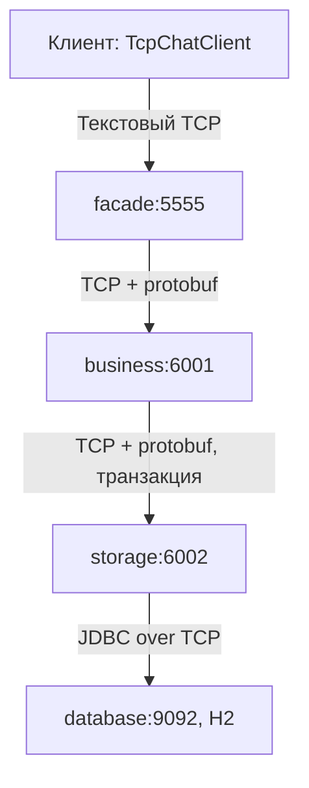

# Лабораторная №5. Слоистая архитектура чата

За основу возвращена лабораторная №4. Разделение сделано по образцу
[lab5 из baranchikov](https://github.com/VadimAlekseyevich/baranchikov/tree/main/lab5):
четыре небольших сервиса, общий protobuf-пакет без генерации Java-классов,
масштабирование числа реплик. У нас сохранён групповой чат и его TCP-протокол.
Mockito, protoc и дополнительные адаптеры предыдущего варианта удалены.

## Слои и классы



| Компонент | Основные классы | Интерфейс и ответственность |
| --- | --- | --- |
| Внешний вход | `FacadeMain`, `ChatFacade`, `TcpChatServer` | `api.Facade`: проверка внешних полей, преобразование в Packet и обратно |
| Бизнес-логика | `BusinessMain`, `model.ChatServer` | `api.ChatService`: состояния пользователей, правила отправки, получатели уведомлений |
| Хранение | `StorageMain`, `H2ChatRepository` | `repository.ChatRepository`: SQL и транзакции |
| База данных | `DatabaseMain` | Стандартный JDBC-интерфейс H2; единственный владелец файла БД |
| Общий обмен | `Packet`, `Wire` | Бинарный формат protobuf, TCP, выбор адреса реплики, перевод данных моделей |

`Main` и имена пакетов `api`, `model`, `runner` сохранены.
`Message`, `UserState`, `ChatMetrics`, `TcpChatClient` выполняют прежние задачи.
`BusinessMain.RemoteRepository` — небольшая сетевая реализация того же ChatRepository.

## Что сохранено из работ №1–4

- Java/Maven, три пользовательских потока, ExecutorService, CountDownLatch и прежние 11 этапов сценария.
- Анна, Вера, Борис и три сообщения; дополнительный ответ и действия выхода в сценарий не добавлены.
- Вывод приложения отсутствует; старые строки печати Main закомментированы.
- История, состояния, настройки и время подключения, счётчики сохраняются в прежних четырёх таблицах H2.
- READ не удаляет уведомление, ACK подтверждает его и не удаляет сообщение из истории.
- Повторный ACK безопасен; неподтверждённые уведомления сохраняются при сбое.
- Пользователь вне сети с включёнными уведомлениями получает очередь после входа.
- Отключение уведомлений запрещает новые записи, но не удаляет уже ожидающие.
- Закрытие TCP-сокета не заменяет DISCONNECT. Сохранённый online восстанавливается как раньше.
- Прежние 11 тестов оставлены; добавлены отдельные проверки новых слоёв.

Сообщения и неподтверждённые уведомления фиксируются одной транзакцией с её счётчиками.
При сбое между обработкой уведомления и ACK возможна повторная выдача того же ID.
Автоматического повтора SEND после ошибки сети нет: результат commit мог остаться неизвестным клиенту.

## Обмен и транзакции

Внешний протокол: UTF-8, поля TAB, конец кадра NUL; экранирование `\\`, `\t`, `\n`, `\r`, `\0`, `\N`.
Команды CONNECT, DISCONNECT, NOTIFICATIONS, SEND, READ, ACK, HISTORY, STATE, USERS, METRICS сохранены.

Внутренний контракт — [chat.proto](src/main/proto/chat.proto):
`Packet { string operation = 1; repeated string values = 2; }`.
Packet.java использует официальные CodedInputStream/CodedOutputStream, а не Java-сериализацию.
Кадр состоит из длины varint и protobuf-тела; Java-код для этой маленькой схемы написан явно,
как в примере. protoc и Maven-плагин генерации не нужны.

Путь SEND: фасад проверяет команду и текст → создаёт Packet → business вызывает ChatServer →
репозиторий открывает BEGIN → сохраняются сообщение, уведомления выбранным пользователям,
счётчики → COMMIT → ответ проходит обратно. Ошибки ARGUMENT/STATE/SERVER сохраняют прежний смысл.

Внутренний CRUD: BEGIN, FIND_USER, SAVE_USER, ADD_MESSAGE, USERS, HISTORY, READ, ENQUEUE,
ACK, COMMIT, ROLLBACK, METRICS. Внешний фасад не допускает CRUD-команды хранения.
Одна транзакция использует одно соединение с одной storage-репликой.

В BEGIN выполняется `SELECT id FROM chat_stats WHERE id = 1 FOR UPDATE`.
Блокировка строки БД согласует операции **всех** реплик, а не только потоков одной JVM.
Схему расширять не понадобилось. JDBC-соединение без commit при закрытии откатывается.
WRITE_DELAY=0 сохранён. METRICS читает счётчики без увеличения requests; успешная операция
ChatService увеличивает requests один раз, независимо от количества внутренних команд.

## IDEA и Maven

Открыть pom.xml как Maven-проект. В Project SDK и Maven Runner выбрать свой JDK 23.0.1.
Целевая версия оставлена 17: контейнеры используют Java 17, отдельно ставить её на Windows не нужно.
В окне Maven: Reload Maven Projects → Lifecycle → clean → package.

Если команда mvn установлена в терминале:

```powershell
mvn clean package
java -jar target/chat.jar
```

Либо запустить Main.main() из IDEA. Это прежняя локальная демонстрация: слои вызываются
через Java-интерфейсы, база data/chat.mv.db, работа без консольного вывода.
В Docker те же правила чата выполняются через распределённую цепочку.
Только тесты: Maven → Lifecycle → test либо `mvn test`.
RestartWriter вручную не запускают — аргументы ему передаёт RestartTest.

## Docker

Docker Desktop должен работать в режиме Linux containers. Из корня проекта:

```powershell
docker compose down --remove-orphans
docker compose config
docker compose build facade tests
docker compose up -d --wait facade
docker compose ps
docker compose run --rm client
docker compose run --rm tests
```

Первый down останавливает старые контейнеры работы №4 или прежней версии №5.
Имя проекта group-chat-lab4 и том chat-data сохранены: файл `/data/chat.mv.db` используется дальше.
`-v` не добавлять, если данные нужны. БД не удаляется и не пересоздаётся скриптами проверки.
Ожидается 19 тестов без падений/ошибок и BUILD SUCCESS. Отчёты Maven/Docker допустимы;
сам чат и его серверы в консоль не печатают.

Внутри Docker клиент подключается к facade:5555. Для каждой реплики фасада публикуется
свободный порт только на 127.0.0.1. Узнать его для программы на Windows:

```powershell
docker compose port facade 5555
```

Это изменение необходимо для нескольких реплик без конфликта одного порта хоста.
Для внешнего ContainerTest можно передать найденный порт как `-Dchat.port=...` и `-Dchat.host=127.0.0.1`.
У business/storage/database публикации портов нет; они соединены соседними внутренними сетями.
Фасад не имеет прямого доступа к сети БД. Файл H2 открывает только database;
несколько storage-реплик соединяются с ним через JDBC over TCP.

Остановка с сохранением данных:

```powershell
docker compose down
```

После изменения кода снова build и up. Для повторного запуска без изменений достаточно up.

## Проверка сохранения данных

После сборки запустить из PowerShell:

```powershell
powershell -ExecutionPolicy Bypass -File .\verify-persistence.ps1
powershell -ExecutionPolicy Bypass -File .\verify-persistence.ps1 -Crash
```

Скрипт использует прежний ContainerTest prepare/verify с уникальным marker:
Анна подтверждает уведомление, Борис остаётся вне сети с неподтверждённым уведомлением.
Между этапами останавливается database: штатно либо через SIGKILL. Затем проверяется
история, состояния и доставка только неподтверждённого уведомления. Том не удаляется.

## Тесты слоёв

Новый DistributedLayersTest содержит независимые проверки:

- фасад отклоняет неверные команды до вызова бизнес-слоя;
- бизнес-правила проверяются с подставным Java-репозиторием, без сети и SQL;
- H2-репозиторий отдельно проверяет commit, rollback, историю и повторный ACK;
- Packet проверяется официальным DynamicMessage protobuf в обе стороны, включая спецсимволы;
- вся цепочка проверяется через H2 TCP и protobuf с повторным открытием БД;
- две storage-реплики одновременно подключают одно имя: успешно проходит только одна операция;
- потеря соединения без COMMIT откатывает пользователя и сообщение.

Старые ChatServerTest, RestartTest, TcpProtocolTest, ContainerTest сохранены без смены пакетов.
Они проверяют прежнее поведение; новый тест проверяет распределённые границы.
Все локальные БД тестов временные. ContainerTest в Docker использует настоящий facade:5555.

## Масштабирование и замеры

Как в примере, масштабируется **число реплик** facade, business и storage: 1, 2 и 3.
Остальные два слоя в каждом сравнении имеют по одной реплике. Database остаётся единственным.
Wire обновляет DNS-адреса и выбирает их по кругу; порядок адресов нормализован,
чтобы изменение порядка DNS не отменяло round-robin. Одна транзакция не прыгает между репликами.

```powershell
powershell -ExecutionPolicy Bypass -File .\benchmark.ps1
```

Скрипт проверяет число работающих реплик до и после нагрузки, использует up --wait
и run --no-deps, затем возвращает по одной реплике. Данные чата не меняются и том не удаляется.
BenchmarkMain выполняет 600 чтений METRICS из 12 потоков после прогрева; пишет только файл.
Измеряется весь запрос через четыре процесса, а не только сериализация.
Можно изменить BENCH_REQUESTS/BENCH_THREADS в окружении перед запуском скрипта.

Результаты на твоём компьютере: benchmarks/benchmark-results.csv и benchmark-comparison.md.
Фактически выполненные замеры этой версии, исходные CSV и условия — [benchmarks/RESULTS.md](benchmarks/RESULTS.md).
Они относятся к отдельным JVM на одном компьютере, а не к запуску Docker-контейнеров.
Docker Engine в среде разработки недоступен; конфигурация проверена по схеме Compose.
Скрипты запуска контейнеров здесь не выполнялись. Эти ограничения не скрыты результатами локальных тестов.

## Выполненные проверки

На OpenJDK 23.0.1+11 (Temurin): сборка JAR и все 19 тестов прошли.
Локальный сценарий дважды завершился без stdout/stderr с одной БД.
Четыре отдельных JVM прошли prepare/verify после штатной остановки и SIGKILL процесса H2;
отдельный клиентский сценарий прошёл через всю цепочку, серверы не писали в консоль.
Выполнено 27 замеров реплик; Docker-конфигурация проверена по официальной JSON-схеме.
Запуск именно Docker-контейнеров в этой среде не выполнялся.

## Контрольные вопросы

**1. Как правильно выделить слои?** По ответственности: ввод, предметные правила, хранение.
Для каждого задают небольшой интерфейс. Верхний слой использует контракт соседнего,
а не его внутренние таблицы и детали реализации.

**2. Пример слоистой архитектуры?** Здесь фасад проверяет SEND, ChatServer определяет
получателей, репозиторий атомарно сохраняет сообщение и уведомления, H2 хранит файл.
Ответ возвращается через те же слои.

**3. Преимущества и недостатки?** Плюсы: понятные обязанности, отдельные тесты,
замена реализаций и независимое масштабирование. Минусы: больше интерфейсов,
преобразований и сетевых переходов; сложнее транзакции и обработка частичных отказов.

**4. Какие протоколы использовать снаружи и внутри?** Для браузера обычно удобны HTTPS/JSON;
в нашем клиенте сохранён текстовый TCP. Внутри выбран protobuf: единая схема и компактное
бинарное представление. Транспорт и границы кадров определяются отдельно.
Ускорение всей системы проверяют замерами, а не предполагают из-за бинарного формата.

**5. Как и зачем отделять защищённый контур?** Публиковать только входной фасад,
нижние слои держать в отдельных внутренних сетях и давать доступ только соседям.
Это ограничивает обход проверок и доступ к данным. Для недоверенной среды дополнительно
нужны аутентификация, авторизация и защищённые каналы; Docker-сеть их не заменяет.

**6. Какие функции возложить на внешний компонент?** Разбор, проверку обязательных полей
и форматов, преобразование протоколов, маршрутизацию и понятные ошибки.
При необходимости — проверку полномочий и ограничение частоты запросов.
Правила получателей и SQL остаются в нижних слоях.
