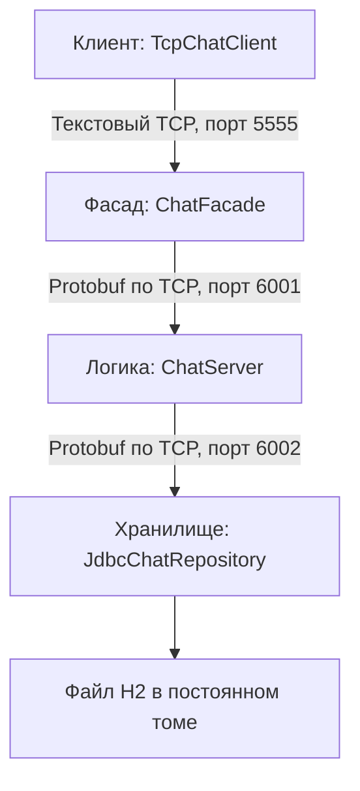

# Лабораторная №5. Слоистая архитектура группового чата

Расширение лабораторной №4: Java, Maven, TCP, H2, Protocol Buffers, Docker Compose и JUnit 5.
Сценарий с Анной, Верой и Борисом, многопоточность, CountDownLatch, история,
настройки пользователей и подтверждения уведомлений сохранены.
Приложение не печатает в консоль: старые строки вывода в Main остаются закомментированными.
Отчёты Maven/JUnit и Docker относятся к инструментам сборки. Замеры пишутся в CSV.

## Что изменилось

Раньше один TcpChatServer одновременно принимал соединения, разбирал команды и создавал
ChatServer, который непосредственно работал с JDBC. Теперь развёртываются три слоя:

| Слой / сервис Compose | Ответственность | Входной интерфейс | Отдельные тесты |
| --- | --- | --- | --- |
| Внешний фасад / `server` | Разбор внешнего текста, проверка аргументов, преобразование в protobuf и обратно | `api.TextEndpoint`, реализация `facade.ChatFacade`; сокеты в `transport` | `layers.FacadeTest` |
| Прикладная логика / `application` | Правила подключения, доступность операций, выбор получателей, единица транзакции | `api.ChatService`, реализация `service.ChatServer`; внутренний адаптер `ApplicationEndpoint` | `layers.ApplicationTest` |
| Хранение / `storage` | SQL, файл H2, атомарность, фиксация и откат, сохранённые счётчики | `storage.ChatRepository` и `ChatTransaction`; реализация `JdbcChatRepository` | `layers.RepositoryTest` |

`api.RpcEndpoint` — типизированный интерфейс внутреннего обмена Request/Reply.
`src/main/proto/chat.proto` — общий контракт сериализации. `layers.InternalProtocolTest`
отдельно проверяет бинарный транспорт и откат при потере соединения с хранилищем.
Слои создаются через конструкторы с интерфейсами: бизнес-логика не импортирует JDBC или сокеты.
`runner` собирает зависимости; `model` содержит Message, UserState и ChatMetrics.



Клиент и контейнер тестов являются потребителями входного фасада, а не дополнительными
владельцами БД. Тестовый контейнер проверяет также остальные слои изолированно.
Spring, HTTP-сервер и gRPC не добавлялись: для этой работы достаточно обычных сокетов
и официальной библиотеки protobuf.

## Протоколы и путь запроса

Внешний протокол лабораторной №3 сохранён: UTF-8, поля разделены TAB,
кадр завершается NUL. Внутри значений экранируются `\\`, `\t`, `\n`, `\r`, `\0`.
Поле `\N` означает null. Пустая строка и null различаются.

Команды: CONNECT, DISCONNECT, NOTIFICATIONS, SEND, READ, ACK, HISTORY, STATE, USERS, METRICS.
Успех начинается с OK, ошибка — ERROR, код и описание. Коды ARGUMENT/STATE/SERVER
преобразуются клиентом в прежние исключения.

Пример SEND:

1. TcpChatClient отправляет поля имени и текста.
2. ChatProtocol выделяет полный кадр; незавершённый кадр не выполняется.
3. ChatFacade проверяет команду, число полей, имя, непустой текст, boolean или положительный ID.
4. Фасад создаёт типизированный protobuf Request. Текстовый кадр между внутренними слоями не пересылается.
5. ApplicationEndpoint вызывает ChatService. ChatServer повторно проверяет допустимость данных и состояние пользователя.
6. ChatServer открывает ChatTransaction через интерфейс репозитория.
7. Хранилище сохраняет сообщение и уведомления выбранным бизнес-слоем пользователям, затем выполняет COMMIT.
8. Ответ с Message проходит обратно через protobuf и преобразуется фасадом во внешний формат.

Protobuf-сообщения передаются как `varint длины + тело`: используются `writeDelimitedTo`
и `parseDelimitedFrom`. Порядок полей и enum определены в .proto; Java-код генерируется Maven
в `target/generated-sources/protobuf/java`, вручную его менять не нужно.
Компилятор protoc и Java runtime имеют одинаковую версию 4.33.0.

Внутренние операции хранилища BEGIN/FIND_USER/SAVE_USER/ADD_MESSAGE/ENQUEUE/COMMIT
недоступны через внешний фасад. Прикладной адаптер тоже отклоняет операции хранения.
Произвольный SQL по сети не принимается.

## Транзакции, восстановление и многопоточность

В одной операции API BEGIN, чтения/изменения и COMMIT используют одно внутреннее TCP-соединение.
RepositoryEndpoint хранит сеанс только этого соединения. ChatTransaction.close без успешного
COMMIT выполняет ROLLBACK. Если приложение оборвалось или канал закрылся, сервер хранилища
закрывает сеанс и откатывает незавершённые изменения. На внутреннем сокете есть таймаут чтения.

У одного файла H2 ровно один владелец — storage. Репозиторий упорядочивает транзакции
ReentrantLock на общем JDBC-соединении. Это сохраняет атомарность проверки состояния,
сообщения, уведомлений и счётчиков при нескольких клиентах. Схема четырёх таблиц из работы №4
не менялась; WRITE_DELAY=0 и явные commit/rollback сохранены.
Успешная транзакция увеличивает requests один раз независимо от числа внутренних RPC.
METRICS и ошибочные операции requests не увеличивают. notifications считает созданные записи,
а не чтения. Prometheus-счётчики предоставляются в прежнем ChatMetrics как снимок.

READ не удаляет уведомления. ACK удаляет пару (получатель, сообщение), оставляя историю.
Повторный ACK безопасен. Подтверждённые уведомления не создаются заново при восстановлении.
Неподтверждённое уведомление может прийти повторно с тем же ID, если клиент завершился до ACK.
Это доставка как минимум один раз, а не обещание строго однократного внешнего эффекта.
Автоматического повторения SEND после сетевой ошибки нет: результат фиксации может быть неизвестен клиенту.
Отключение уведомлений запрещает создание новых записей, но не удаляет уже ожидающие.
Зарегистрированный пользователь вне сети получает очередь после CONNECT и READ.
Закрытие сокета не заменяет явную команду DISCONNECT; сохранённый online восстанавливается как раньше.

Пользовательский сценарий использует три задачи ExecutorService и 11 пар CountDownLatch.
Сокеты фасада читаются отдельными задачами; ограниченный пул операций фасада занят только
обработкой команд, поэтому один обработчик не блокирует все постоянные соединения.
Внутренние серверы имеют настраиваемое число обработчиков; один обработчик хранилища
ведёт одну транзакцию. Параметры FACADE_WORKERS/APPLICATION_WORKERS/STORAGE_WORKERS
задают размеры пулов, по умолчанию 4.

## Сборка и запуск из IDEA

Открыть pom.xml как Maven-проект. JDK 23.0.1 пользователя подходит; целевая версия в pom.xml — 17.
В Project SDK и Maven Runner выбрать установленный JDK. Выполнить Reload Maven Projects.
Первой сборке нужен интернет для загрузки Maven-зависимостей и protoc.

В окне Maven выполнить `Lifecycle → clean`, затем `Lifecycle → package`.
В терминале с установленным Maven эквивалентная команда:

```powershell
mvn clean package
```

Получится исполняемый `target/chat.jar` с зависимостями. Стартовый класс — `runner.Main`.
Локальная демонстрация без Docker:

```powershell
java -jar target/chat.jar
```

Она запускает всю цепочку слоёв по TCP на свободных локальных портах, выполняет прежний
сценарий и закрывает ресурсы. База — data/chat.mv.db. Повторный запуск добавляет три сообщения.
Также можно запустить Main.main() из IDEA. Вывод отсутствует при успешном выполнении.
`RestartWriter` — помощник теста; вручную его запускать не нужно.

Для запуска каждого процесса вручную в отдельных терминалах (из корня проекта):

```powershell
java -jar target/chat.jar storage data/chat 6002 127.0.0.1 4
java -jar target/chat.jar application 6001 127.0.0.1 127.0.0.1 6002 4
java -jar target/chat.jar server 5555 127.0.0.1 127.0.0.1 6001 4
java -jar target/chat.jar client 127.0.0.1 5555
```

Первые три команды работают до Ctrl+C; четвёртая выполняет сценарий и завершается.
Последний аргумент серверных режимов — число обработчиков.
Не запускать этот вариант одновременно с локальной демонстрацией на той же БД.

Все тесты из IDEA: запуск src/test/java либо `Maven → Lifecycle → test`.
Из терминала:

```powershell
mvn test
```

## Docker: сборка и запуск

Нужен работающий Docker Desktop с Linux-контейнерами. Команды вводятся в папке с compose.yaml.

Имя Compose-проекта group-chat-lab4 специально сохранено: существующий том
`group-chat-lab4_chat-data` лабораторной №4 будет использован новым storage.
Перед первым запуском новой архитектуры остановить прежний сервер, чтобы два процесса
не открывали один файл H2. Том не удалять.

```powershell
docker compose down --remove-orphans
docker compose config
docker compose build server tests
docker compose up -d --wait server
docker compose ps
docker compose run --rm client
docker compose run --rm tests
```

Первый build создаёт образ приложения; тот же образ используют storage, application и client.
Образ tests отдельный. Maven и Java для контейнеров загружаются по Dockerfile,
глобальный Maven на Windows для этих команд не нужен.
Зависимости запускаются последовательно: storage → application → server.
Healthcheck проверяет доступность всей нижележащей цепочки командой METRICS без изменения счётчиков.
Клиентский сценарий и приложение не печатают сообщения в консоль; Maven выводит отчёт тестов.
Ожидается `Tests run: 28, Failures: 0, Errors: 0, Skipped: 0` и `BUILD SUCCESS`.

Сети:

| Сеть | Участники | Назначение |
| --- | --- | --- |
| frontend | server, client, tests | Внешний текстовый интерфейс |
| backend (internal) | server, application | Бинарные запросы к бизнес-слою |
| data (internal) | application, storage | Бинарные транзакции репозитория |
| downloads | tests | Загрузка Maven-зависимостей во время тестов |

Только server публикует порт `127.0.0.1:5555:5555`.
У application и storage публикации портов нет. Фасад не подключён к сети data.
Имена application и storage — DNS-имена сервисов Compose, а не адреса для клиента на Windows.
Изоляция сетей и проверка команд разделяют внешний и внутренний контуры; аутентификация,
TLS и противодействие недоверенному администратору Docker в задание не добавлялись.

Штатная остановка:

```powershell
docker compose down
```

Не добавлять -v, если нужны данные: этот ключ удаляет тома.
После изменения кода снова выполнить build и up. Обычный повторный запуск не требует пересборки.

## Проверка сохранения БД между контейнерами

В одном окне PowerShell, с уже запущенным сервером:

```powershell
$marker = [guid]::NewGuid().ToString("N")
docker compose run --rm tests "-Dtest=ContainerTest" "-Dchat.phase=prepare" "-Dchat.marker=$marker"
docker compose up -d --force-recreate --wait server
docker compose run --rm tests "-Dtest=ContainerTest" "-Dchat.phase=verify" "-Dchat.marker=$marker"
```

prepare создаёт уникальных пользователей и сообщение: Анна онлайн и подтвердила уведомление,
Борис офлайн и не подтвердил. verify не создаёт их заново и проверяет сохранённые данные.
Между этапами сохранять marker и не запускать клиентскую демонстрацию.

Аварийный вариант — новый marker, prepare, затем:

```powershell
$marker = [guid]::NewGuid().ToString("N")
docker compose run --rm tests "-Dtest=ContainerTest" "-Dchat.phase=prepare" "-Dchat.marker=$marker"
docker compose kill -s SIGKILL storage
docker compose up -d --wait server
docker compose run --rm tests "-Dtest=ContainerTest" "-Dchat.phase=verify" "-Dchat.marker=$marker"
```

## Тесты лабораторной №5

Изолированные проверки не требуют запуска Docker:

- FacadeTest использует подставной RpcEndpoint: проверка входных аргументов, преобразование
  в protobuf, обратный формат, обработка ошибок. БД и бизнес-слой не запускаются.
- ApplicationTest подставляет ChatRepository/ChatTransaction: проверка правил получателей,
  повторного входа, времени подключения, запрета операций офлайн и границ commit/close.
  JDBC и сеть не используются.
- RepositoryTest работает непосредственно с временной H2: фиксация, повторное открытие,
  идемпотентный ACK, откат при ошибке, конкурентные транзакции. Фасад и логика не запускаются.
- InternalProtocolTest проверяет настоящий бинарный TCP-обмен и откат незавершённого сеанса
  после потери канала. Внутренние ошибки передаются клиенту без Java-сериализации исключений.

Прежние 11 тестов не удалены: ChatServerTest, RestartTest, TcpProtocolTest и ContainerTest
проходят через LayeredChat, то есть через оба protobuf-перехода.
RestartWriter запускает всю цепочку в дочерней JVM; проверяются штатное закрытие,
halt без finally и восстановление после незавершённой транзакции.
Прямой JDBC в старых тестах нужен только для искусственных сбоев.
@TempDir и свободные порты отделяют тесты от рабочей БД.
Внутри tests-контейнера ContainerTest обращается к реальному server:5555;
при запуске из IDEA без CHAT_PORT создаёт временную локальную цепочку.

## Замеры при масштабировании компонентов

Используется вертикальное масштабирование числа обработчиков каждого слоя: 1, 2 и 4.
При изменении одного слоя остальные два имеют по 4 обработчика. Общая точка (4,4,4)
используется для всех трёх сравнений; дополнительно измеряется (1,1,1).
Это не горизонтальное клонирование контейнеров и не измерение сетевой задержки между машинами.
Для H2 намеренно не создаются независимые реплики одного файла: без согласования это
привело бы к разным историям либо конфликту владельцев БД.

BenchmarkMain запускает три **отдельных JVM-процесса** из того же JAR, с теми же
фасадом, protobuf-протоколом, сервисом и репозиторием. У каждого процесса свой пул.
На каждый повтор создаётся новая временная БД; рабочая история не используется.
У каждой дочерней JVM одинаковый фиксированный предел heap: -Xms32m -Xmx128m.
8 клиентов подключаются до начала нагрузки, каждый выполняет 5 SEND прогрева,
затем 50 измеряемых SEND. У всех включены уведомления.
Замеряется полный путь внешнего запроса до COMMIT и ответа: всего 400 измеряемых операций.
После прогона сверяются число сообщений, запросов и уведомлений; ошибка прерывает замер,
не превращается в успешную строку отчёта. Задержки измеряются System.nanoTime,
p50/p95 — по операциям, throughput — операции / время завершения всей группы.
Порядок конфигураций перемешивается с фиксированным seed, выполняются 3 повтора.

После сборки:

```powershell
java -jar target/chat.jar benchmark benchmarks/scaling.csv 3 8 50
```

Аргументы: файл CSV, число повторов, число клиентов, сообщений на клиента.
Программа не печатает в консоль; дождаться её завершения.
Результат — benchmarks/scaling.csv и scaling-environment.txt рядом с ним.

Тот же замер в изолированном контейнере:

```powershell
docker compose run --rm benchmark
```

benchmark не меняет production-сервисы: внутри него запускаются три JVM с loopback TCP,
а файлы результатов записываются в папку benchmarks на компьютере.
Сеть выключена, кроме loopback; JAR уже содержит зависимости.
Таким способом сравниваются обработчики процессов, а не накладные расходы трёх отдельных контейнеров.

Результаты выполненного замера и их сравнение приведены в [benchmarks/RESULTS.md](benchmarks/RESULTS.md).
Исходные CSV и описание среды сохранены рядом. Эти числа относятся только к указанной среде
и нагрузке; увеличение числа потоков не гарантирует линейного ускорения.

## Фактически выполненная проверка

- Maven package на полном OpenJDK 23.0.1+11 (Temurin), release 17: 28 тестов, 0 падений, 0 ошибок, 0 пропусков.
- Исполняемый JAR дважды выполнил сценарий с одной БД без stdout/stderr; проверены manifest, JDBC service и целевая версия классов.
- Три независимых серверных процесса с одним обработчиком на слой прошли prepare/verify после штатной остановки storage и после SIGKILL. Отдельный клиентский сценарий также прошёл; серверы не писали в stdout/stderr.
- Выполнены 24 нагрузочных прогона: результаты и сравнение находятся в benchmarks/RESULTS.md.
- compose.yaml проверен по официальной JSON-схеме Compose и по настройкам разделения сетей.
- Docker Engine в среде исполнения отсутствует. Сборка образов и запуск именно Docker-контейнеров здесь не выполнялись; их нельзя считать подтверждёнными указанными процессными проверками. Команды для проверки в Docker Desktop приведены выше.

## Официальные источники

- [Protocol Buffers: Java](https://protobuf.dev/getting-started/javatutorial/)
- [Protobuf: кадры с длиной](https://protobuf.dev/reference/java/api-docs/com/google/protobuf/MessageLite)
- [Совместимость версий protobuf](https://protobuf.dev/support/cross-version-runtime-guarantee/)
- [Docker Compose: сети](https://docs.docker.com/compose/how-tos/networking/)
- [Docker Compose: внутренние сети](https://docs.docker.com/reference/compose-file/networks/)

## Ответы на контрольные вопросы

### 1. Как правильно выделить слои при построении архитектуры ПО?

По ответственности и причинам изменения: пользовательский ввод, правила предметной области,
хранение данных. Для каждого слоя задают небольшой явный интерфейс. Верхний слой обращается
к соседнему через контракт, а не к его внутренним классам или таблицам. Детали сети и JDBC
не должны проникать в правила чата. Слои выбираются по задачам, а контейнеры — по способу
развёртывания: это связанные, но разные понятия.

### 2. Приведите пример слоистой архитектуры.

В этой работе фасад принимает SEND и проверяет текст; прикладной слой проверяет состояние
пользователя и выбирает получателей; слой хранения атомарно записывает сообщение и уведомления.
Ответ проходит обратно. Реализацию хранения можно заменить, сохранив ChatRepository.

### 3. Какие преимущества и недостатки даёт слоистая архитектура?

Преимущества: разделение ответственности, независимые тесты, замена реализации за интерфейсом,
понятные границы, возможность отдельно настраивать ресурсы компонентов.
Недостатки: дополнительные контракты и преобразования; при разделении по процессам —
сетевые задержки, частичные отказы и сложнее управление транзакциями.
Слишком мелкое деление увеличивает объём кода без полезной независимости.

### 4. Какие протоколы предпочтительны для пользовательского интерфейса и внутренних взаимодействий и почему?

Для браузерного интерфейса обычно удобны HTTP/HTTPS и JSON: стандартные инструменты,
отладка и совместимость. В нашем учебном клиенте сохранён понятный текстовый TCP-протокол.
Для внутренних соединений выбран protobuf: типизированный контракт, компактное бинарное
представление, автоматическая генерация Java-кода, правила развития схемы.
Сам protobuf задаёт сериализацию, поэтому границы кадров и транспорт определены отдельно.
Выбор делается по требованиям и замерам: бинарный формат сам по себе не гарантирует ускорения всей системы.

### 5. Как и зачем разделять защищённый контур компонентов от внешнего?

Публиковать пользователю только входной компонент. Бизнес-логику и БД размещать во внутренних
сетях, не публиковать их порты, давать компонентам доступ только к соседям по архитектуре.
Это уменьшает поверхность доступа и мешает обходить фасад, его проверки и контракт.
В работе facade/server связан с backend, application — с backend и data, storage — только с data.
Для недоверенной среды к этому добавляют аутентификацию, авторизацию и защищённые каналы.
Изолированная Docker-сеть сама по себе не заменяет эти механизмы.

### 6. Какие функции можно возложить на внешний компонент, доступный пользователю?

Разбор запросов, проверку формата, размеров и обязательных полей, преобразование внешних
форматов во внутренние, маршрутизацию, нормализацию ошибок и сбор технических метрик.
При необходимости — аутентификацию, проверку полномочий и ограничение частоты запросов.
В этой работе фасад разбирает команды, проверяет аргументы и преобразует текст в protobuf;
правила получателей и транзакции остаются в нижних слоях.
